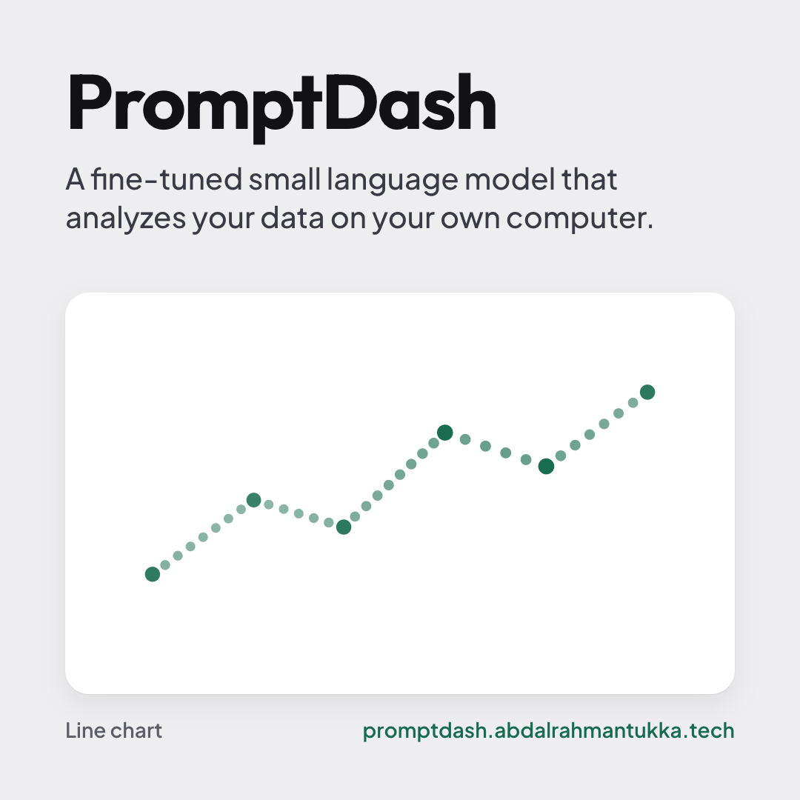

<p align="center">
  <a href="https://promptdash.abdalrahmantukka.tech">
    
  </a>
</p>

# PromptDash

A 9B model fine-tuned to build full dashboards and charts from one prompt. It runs on your Mac, and your data stays there.

Three dashboards it built, and how it was made, are at [promptdash.abdalrahmantukka.tech](https://promptdash.abdalrahmantukka.tech).

## What it does

- Ask in plain words for a whole dashboard, such as "revenue by customer region", or for a single chart.
- Use your own data: CSV or Excel (.xlsx) files, or the tables of a PostgreSQL, MySQL or MariaDB database.
- The model on your Mac plans the dashboard and writes the code that draws every chart.
- Move and resize the charts on a canvas, add notes beside them, and come back to the report later.

## How it works

PromptDash runs Qwen3.5-9B on your Mac with one LoRA adapter on top. A LoRA adapter is a small set of extra weights, trained for a task while the model's own weights stay unchanged. This one, lora-v2, was trained for three jobs:

- the analyst reads a summary of your tables and proposes what the dashboard should show;
- the planner turns each idea into a chart plan, which names the kind of chart, the columns, and how to group the rows (for example, an average per month);
- the chartist writes the Python code that draws each chart with Plotly, a charting library.

Code checks every chart plan against your real tables. A plan that names a column the table does not have, or that would draw a chart too crowded to read, goes back to the planner with the problem in plain words. Every chart is drawn by the model's own code. If that code fails, the model gets the error back and up to two tries to fix it. A chart that still fails is reported as failed, with the reason, and no template chart is drawn in its place.

[AGENTS.md](AGENTS.md) records the measured decisions behind this design, and [chartist-finetune/README.md](chartist-finetune/README.md) covers the fine-tune.

## Quick start on a Mac

### Set it up with a coding agent

If you use a coding agent such as Claude Code or Codex, paste this into it:

```text
Set up PromptDash on this Mac from https://github.com/tukka25/BYD. Clone it, read README.md and AGENTS.md, then follow the README's "Quick start on a Mac" in order and finish with make smoke. Run make doctor first and tell me what is missing. Ask me before installing anything system-wide (Docker Desktop, Python, Node.js) or downloading more than the 6 GB base model. The trained adapter is not in the repository: if chartist-finetune/cloud/artifacts/out-v2/ is empty, stop there and tell me. Put the two lines make secrets prints into .env, and never print or commit that file.
```

Or follow the steps yourself.

### What you need

- A Mac with Apple Silicon. The model runs on the Mac itself, outside Docker, because MLX (Apple's machine-learning framework) needs the Mac's GPU and a container cannot reach it.
- Docker Desktop, running. The web app, the API and its Postgres database run in containers.
- Python 3, and Node.js with npm.

`make doctor` reports what is missing, one line each for Docker, the API, the model server, the sample CSVs, the adapter and the base model. `make help` lists every command.

### 1. Clone and install

```bash
git clone https://github.com/tukka25/BYD.git
cd BYD
make setup
```

`make setup` installs the API's Python packages and the web app's npm packages, and writes four sample CSV files into `backend/uploads/`.

### 2. Put the model on your Mac (once)

The model has its own Python environment in `chartist-finetune/`. Create it and install mlx_lm, the MLX tool that runs language models:

```bash
python3 -m venv chartist-finetune/.venv
chartist-finetune/.venv/bin/python -m pip install -U mlx-lm
```

Download the base model, a 4-bit (compressed) copy of Qwen3.5-9B made for MLX. It is 5.98 GB.

```bash
chartist-finetune/.venv/bin/hf download mlx-community/Qwen3.5-9B-MLX-4bit --local-dir chartist-finetune/models/qwen3.5-9b-4bit
```

The adapter's weights are not in the repository; they come from a training run on a rented GPU, described in [chartist-finetune/cloud/README.md](chartist-finetune/cloud/README.md). Put the trained adapter in `chartist-finetune/cloud/artifacts/out-v2/`, then convert it to MLX format:

```bash
make adapter
```

### 3. Replace the placeholder secrets

The repository ships placeholder values for `SECRET_KEY` and `ENCRYPTION_KEY`, and they are public. Anyone with this code could use them to forge sign-in tokens and read the database passwords you save. Print fresh ones, then paste the two lines into a `.env` file at the repository root:

```bash
make secrets
```

Do this before you add a database connection. Changing `ENCRYPTION_KEY` later makes saved connection passwords unreadable, and you would have to enter each connection again.

### 4. Start it

```bash
make serve-model   # terminal 1: the model, leave it running
make up            # terminal 2: Postgres, the API and the web app
make smoke         # terminal 2: draws one real chart to check it all works
```

Open http://localhost:3000 and sign in with an email address and a password. The first sign-in creates the account in your local database. The API's docs are at http://localhost:8000/docs.

A dashboard takes minutes to build, because the model writes every plan and every chart. `make down` stops the app.

## Privacy

Dashboards and charts are built by the model on your Mac, and your data is not sent to any outside service. The only exception is the optional Compare models page, which sends the same chart questions to the local model and to Claude Opus 5.5, through Anthropic's API, and shows their charts side by side. It runs only when you set `CLAUDE_API_KEY` (or `ANTHROPIC_API_KEY`) in `.env`. For each chart it sends Claude the question the app wrote for it, the table's column names and types, and three rows from the table. When Claude's code fails, it also sends that code back with the error message.

## What's in the repository

| Folder | What it holds |
| --- | --- |
| [`backend/`](backend/) | The API, in Python (FastAPI): sign-in, data sources, the model's jobs and the checks on its work |
| [`byd-web/`](byd-web/) | The web app, in Next.js: reports, the chart canvas, data sources and the Compare models page |
| [`chartist-finetune/`](chartist-finetune/) | The fine-tune: the training data, the training runs and the evaluations behind every result |
| [`web-crawler/`](web-crawler/) | A Scrapy crawler of the Plotly documentation, where the first training data came from |
| [`site/`](site/) | The landing page, a static Next.js site |
| [`langchain-archeticture/`](langchain-archeticture/) | A standalone LangGraph example, separate from the app |

## Further reading

- [AGENTS.md](AGENTS.md) lists the measured decisions and the gotchas, for anyone changing the code.
- [chartist-finetune/README.md](chartist-finetune/README.md) explains how the training data was built and checked.
- [chartist-finetune/cloud/README.md](chartist-finetune/cloud/README.md) covers the training runs on a rented GPU, and how lora-v1 and lora-v2 scored.
- [site/README.md](site/README.md) explains how the landing page is built, tested and deployed.
